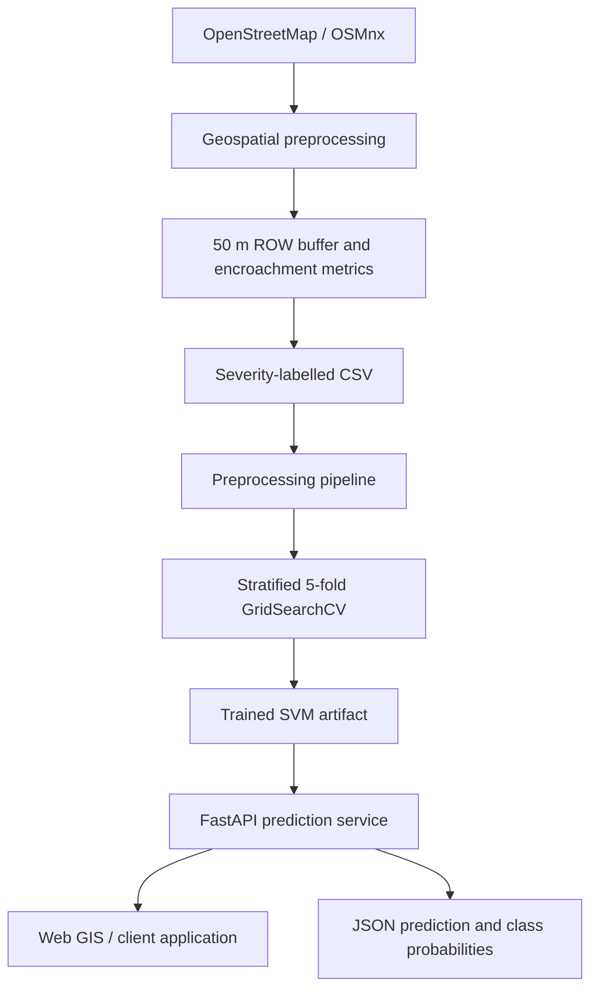

# Web GIS Urban Road Reserve Encroachment Mapping & Spatial Analysis

**Case study:** Outer Ring Road, Nairobi, Kenya  
**Programme:** MSc Data Science & Analytics - DSA 8401 Applied Machine Learning  
**Institution:** Strathmore University

## 1. Project overview

This project combines OpenStreetMap data extraction, geospatial processing, road-reserve buffer analysis, encroachment severity classification, spatial hotspot analysis and a web-based decision-support interface.

The existing research notebook and final research paper are preserved in `notebooks/` and `reports/`. The repository is being extended into a reproducible machine-learning application that can be run outside a notebook.

## 2. System architecture



## 3. Repository structure

```text
road-encroachment-ml/
├── README.md
├── AI_USE.md
├── requirements.txt
├── Dockerfile
├── docker-compose.yml
├── .dockerignore
├── .gitignore
├── notebooks/
│   └── encroachment_mapping_project.ipynb
├── reports/
│   ├── encroachment_project_final.pdf
│   └── DSA8401_capstone_brief.pdf
├── data/
│   ├── raw/
│   └── processed/
├── src/
│   ├── __init__.py
│   └── train_model.py
├── models/
├── outputs/
├── api/
│   └── main.py
└── tests/
```

## 4. Environment setup

Python 3.11 is recommended.

```bash
git clone <YOUR_GITHUB_REPOSITORY_URL>
cd road-encroachment-ml

python -m venv .venv
# Windows:
.venv\\Scripts\\activate
# macOS/Linux:
source .venv/bin/activate

pip install -r requirements.txt
```

## 5. Data preparation

Run the original notebook in order to download and process the OpenStreetMap features. The notebook's final export cell writes:

- `buildings_raw.csv`
- `outer_ring_road.csv`
- `encroachments_analysis.csv`

Place `encroachments_analysis.csv` in `data/processed/` before training.

> OpenStreetMap/Overpass availability and query limits can affect extraction. Keep a dated copy of the processed input used for a particular experiment so the run can be reproduced.

## 6. Train and evaluate the model

```bash
python -m src.train_model --input data/processed/encroachments_analysis.csv
```

The training script performs a stratified hold-out split, fits preprocessing within a scikit-learn pipeline, tunes an RBF SVM using stratified cross-validation, and saves:

- `models/encroachment_svm.joblib`
- `outputs/model_metrics.json`
- `outputs/classification_report.json`

Metrics are generated from the current run; they are not copied from manually entered notebook tables.

### Latest run on the supplied CSV

The supplied `encroachments_analysis.csv` contained **1,700 rows**. The reproducible run used a stratified 80:20 split (1,360 training rows; 340 test rows) and selected `C=100`, `gamma=0.01`.

| Metric | Result |
|---|---:|
| Hold-out accuracy | 98.24% |
| Weighted F1 | 98.24% |
| Macro F1 | 98.06% |
| Best 5-fold CV weighted F1 | 97.58% |

These scores describe reproduction of the existing depth-based severity labels. They must not be interpreted as future-event prediction performance or as external spatial validation.

### Important interpretation note

The notebook defines severity deterministically from encroachment depth. A model trained with depth or variables derived from depth learns to reproduce that severity rule. This is an **automated severity classification** task, not evidence that the model forecasts future encroachment. The report and presentation must describe this distinction accurately. A genuinely prospective model would require independently observed future outcomes or historical time-stamped labels.

## 7. Run the prediction API locally

Train the model first, then run:

```bash
uvicorn api.main:app --host 0.0.0.0 --port 8000 --reload
```

Open `http://localhost:8000/docs` for interactive API documentation and `http://localhost:8000/health` for the health check.

Example request (the exact required fields are documented by the API schema):

```json
{
  "distance_to_road": 12.0,
  "encroachment_depth": 38.0,
  "encroachment_area": 120.0,
  "building_area": 180.0,
  "encroachment_percentage": 66.7,
  "building_type": "commercial",
  "latitude": -1.2864,
  "longitude": 36.8792
}
```

## 8. Run with Docker

```bash
docker compose up --build
```

The API is exposed at `http://localhost:8000`. The model artifact must exist in `models/` before the service starts. For a first build, train locally before running Compose.

## 9. Reproducibility

- Random seeds are fixed in the training script.
- The hold-out split is stratified.
- Preprocessing is fitted only on training folds through a scikit-learn `Pipeline`.
- Hyperparameter selection uses stratified cross-validation.
- The script writes the metrics and model artifact from the same execution.

For full data acquisition and geospatial analysis, see the preserved notebook.

## 10. Limitations

- OpenStreetMap building tags may be missing or generalized.
- The analysis is cross-sectional and does not establish temporal growth.
- The severity classes are rule-derived from measured encroachment depth.
- Performance on Outer Ring Road does not establish generalization to other corridors.
- Field verification and authoritative road-reserve boundaries are needed before enforcement decisions.

## 11. Academic integrity and AI disclosure

See [`AI_USE.md`](AI_USE.md). Review and update it to reflect the actual tools and assistance used in the final submission.
